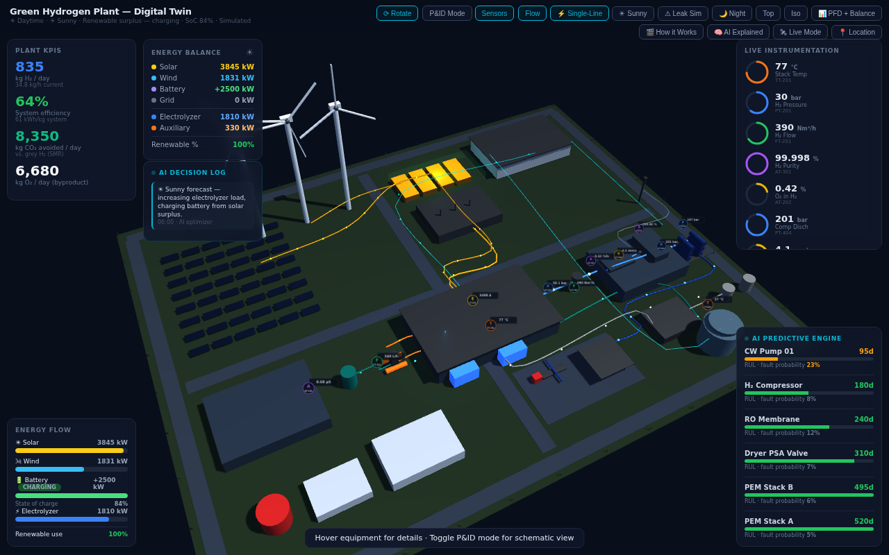

# Green Hydrogen Plant — Digital Twin

An interactive 3D digital twin of a **1 tonne/day green hydrogen plant**, combining a live
SCADA-style supervisory view, a simulated process/energy model, and an AI predictive-maintenance
layer. Optionally driven by **real measured weather** at any location on earth.



---

## Quick start

```bash
git clone <this-repo>
cd zar
npm start
```

Then open **http://localhost:3000**.

No install step, no build step, no dependencies — `npm start` runs `server.js`, a ~120-line
zero-dependency Node static server.

**Alternatives**

| Command | Notes |
|---|---|
| `npm start` | Node server on port 3000 (default) |
| `node server.js --port 8080` | Any other port |
| `PORT=8080 npm start` | Same, via environment variable |
| `node server.js --host 0.0.0.0` | Expose on your LAN (e.g. to demo from a phone) |
| `npm run serve:python` | Python fallback: `python3 -m http.server 3000 --directory public` |
| `npx http-server public -p 3000` | Any other static server works too |

Requires Node 18+ (only for the dev server; the app itself is plain browser JS).

### Why serve it instead of double-clicking the HTML?

Opening the page as a `file://` URL mostly works, but browsers treat `file://` as an insecure
origin and **block the Geolocation API**, so "Use my GPS location" in Live Mode silently fails.
`http://localhost` *is* a secure origin, so on localhost the full feature set works.

---

## What the project is

A single-page WebGL application. There is no backend, no database and no build pipeline — the
entire plant model, physics simulation and AI layer run in the browser at ~60 fps.

### Architecture

```
public/
├── index.html              # DOM: canvas + HUD panels + 3 full-screen overlays
├── css/styles.css          # all styling (dark SCADA theme)
├── js/app.js               # the whole engine (~1,700 lines, see breakdown below)
└── vendor/three/
    ├── three.min.js        # three.js r128, served locally → works fully offline
    └── LICENSE             # MIT
server.js                   # zero-dependency static file server
package.json                # scripts only, no dependencies
```

`app.js` is one classic (non-module) script. It exposes a single global namespace, `T`, which the
inline `onclick` handlers in `index.html` call — e.g. `T.togglePID()`, `T.setLeak('compressor')`,
`T.setWeather('storm')`. Handy for driving the twin from the browser console.

### `app.js` in layers

| Lines | Layer | What it does |
|---|---|---|
| 1–62 | Scene setup | Renderer, camera, lights, shared materials, plant coordinate helper `P(x,y,z)` |
| 63–145 | Plant geometry + piping | Solar farm, 3 wind turbines, BESS, substation, water treatment, PEM electrolyzer hall, separators, PSA dryer, compressors, H₂/O₂ storage, cooling tower, dispatch bay — 19 hoverable equipment zones |
| 146–223 | Flow particles + instrumentation | Process flow animation, plus 12 sensor sprites (TT-201, PT-201, FT-201, AT-202, AT-301, PT-404, VT-401, PT-501, TT-601, FT-101, IT-202, AT-101) as billboarded canvas textures |
| 224–259 | Leak simulation | Particle plumes + ground warning ring, repositioned per leak site |
| 260–294 | Electrical | Animated power cables and energy-flow particles, battery glow |
| 295–329 | Weather FX | Rain field (1,400 points), volumetric clouds, lightning flash |
| 330–456 | **Live weather** | Open-Meteo integration, wind-shear extrapolation to 80 m hub height, WMO code → visual mode |
| 457–688 | **Process simulation** | The actual model: solar/wind generation, battery dispatch, electrolyzer load, H₂/O₂ production, efficiency, degradation, alarm logic |
| 689–829 | Dashboard rendering | KPI panel, gauges, energy flow/balance, AI decision log, RUL list, maintenance alerts |
| 830–1109 | UI controls | P&ID mode, orbit controls, view presets, dropdowns, single-line diagram, leak/weather/location handlers |
| 1110–1544 | Overlays | PFD + mass/energy balance, "How it Works" (10 animated steps), "AI Explained" (7-step pipeline + live anomaly chart) |
| 1545–1714 | Main loop | `animate()` — physics at frame rate, UI repaint throttled to ~6 Hz |

### Simulation model

Not a random-number generator — it is a small but coherent plant model:

- **Generation** — solar follows a daylight curve × weather multiplier; wind uses a real turbine
  power curve (cut-in 3 m/s, rated 12 m/s, cut-out 25 m/s) against hub-height wind speed.
- **Dispatch** — surplus renewable charges the battery; deficit discharges it; the electrolyzer
  load ramps within limits rather than stepping.
- **Production** — H₂ from electrolyzer power at 52 kWh/kg at the stack, plus a largely fixed 330 kW
  balance-of-plant load spread over actual output — so **specific energy rises and efficiency drops at
  part load**, exactly as a real plant behaves. Efficiency is reported on an HHV basis (39.4 kWh/kg).
  O₂ byproduct ≈8 kg per kg H₂ (stoichiometric 7.94), CO₂ avoided vs. grey (SMR) hydrogen ~10 kg/kg.
- **Design basis** — 41.67 kg H₂/h (1,000 kg/day), 2,497 kW total plant demand, 66% system
  efficiency (HHV), 525 kW recoverable stack waste heat. Full mass/energy/environmental balance
  tables are in the **PFD + Balance** overlay.

### AI layer

Six tracked assets (PEM Stack A/B, H₂ Compressor, CW Pump 01, RO Membrane, Dryer PSA Valve) each
carry a remaining-useful-life estimate and fault probability that degrade over time and accelerate
under stress (storm operation, leaks, high stack temperature). Advisories are raised at >25% fault
probability, and work orders auto-generate below 60 days RUL. The **AI Explained** overlay documents
the method (Isolation Forest anomaly scoring + Weibull survival RUL) and lists all 9 notional AI
modules with TRL ratings.

---

## Features / controls

| Control | What it does |
|---|---|
| **⟳ Rotate** | Toggle camera auto-orbit (drag to orbit, scroll to zoom) |
| **P&ID Mode** | Flatten to a schematic top-down process-and-instrumentation view |
| **Sensors / Flow** | Toggle sensor tag sprites and flow particles |
| **⚡ Single-Line** | Animated single-line electrical diagram |
| **⛅ Weather** | Force sunny / cloudy / rainy / storm and watch generation respond |
| **⚠ Leak Sim** | Inject a leak at 7 locations → plume, gas-detector alarm, AI response |
| **🌙 Night** | Night lighting, site floodlights, solar → zero |
| **Top / Iso** | Camera presets |
| **📊 PFD + Balance** | Process flow diagram + full mass/energy/environmental balance |
| **🎬 How it Works** | 10-step animated walkthrough of the process |
| **🧠 AI Explained** | Sensor→prediction pipeline with a live anomaly-detection chart |
| **🛰 Live Mode** | Drive solar and wind from **real measured weather** |
| **📍 Location** | Set the plant location by GPS, network/IP, or city name |

Press **Esc** to close any overlay.

---

## Network access

The twin runs **fully offline** — three.js is vendored locally, and every panel except Live Mode
works with no internet connection.

Live Mode is the one exception. It calls these public APIs directly from the browser (no API keys
required):

| Service | Used for |
|---|---|
| `api.open-meteo.com` | Current temperature, wind speed, cloud cover, precipitation, irradiance |
| `geocoding-api.open-meteo.com` | City name → coordinates |
| `api.bigdatacloud.net` | Coordinates → readable place name |
| `ipapi.co` / `ipwho.is` | Network/IP-based location detection |

If any of them are blocked, Live Mode logs a warning and falls back to simulated weather — it never
breaks the page. Real weather is re-fetched every 10 minutes while Live Mode is on.

---

## Development

Source files are served with `Cache-Control: no-cache`, so editing `public/css/styles.css` or
`public/js/app.js` and reloading is enough — no watcher or rebuild. (`public/vendor/` is served
immutable and long-cached.)

To auto-restart the server when `server.js` itself changes:

```bash
npx nodemon server.js
```

The server serves only files inside `public/`; path traversal outside that directory is rejected.

---

## License

Application code: MIT. Bundled three.js r128 is MIT — see `public/vendor/three/LICENSE`.
